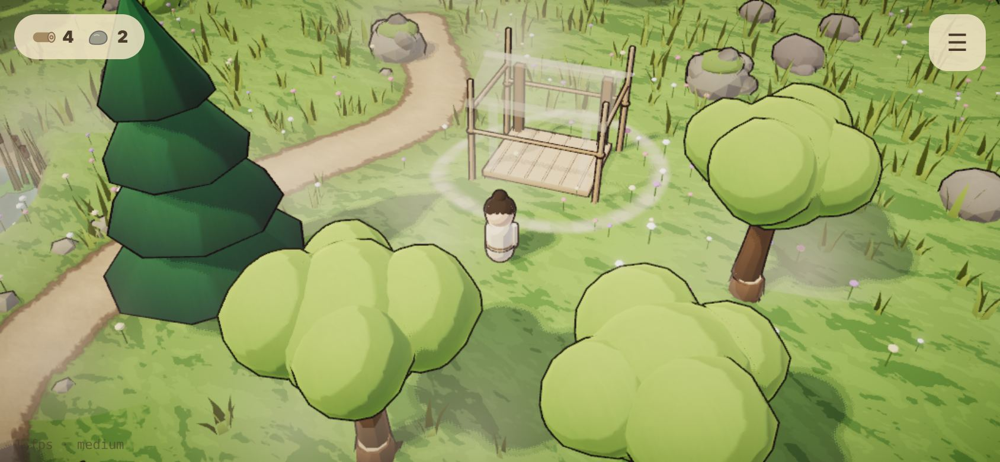
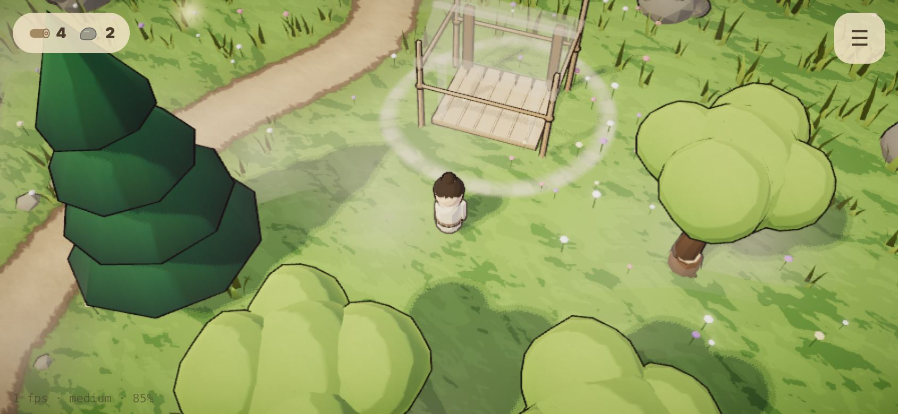
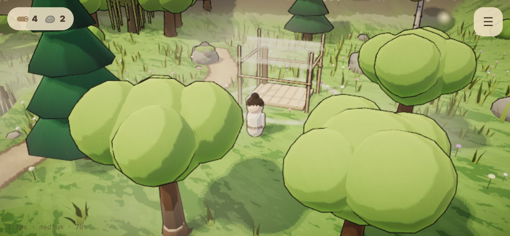
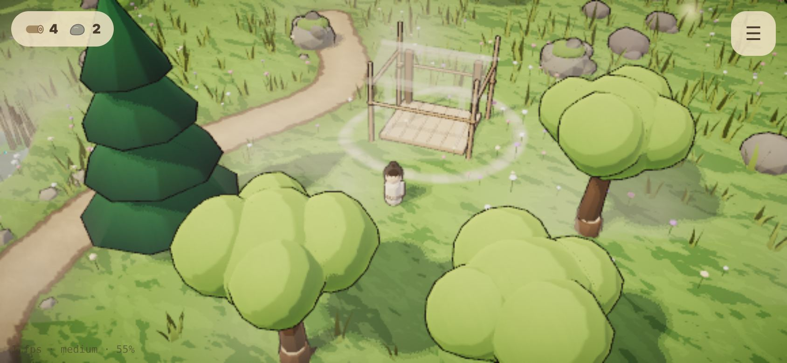
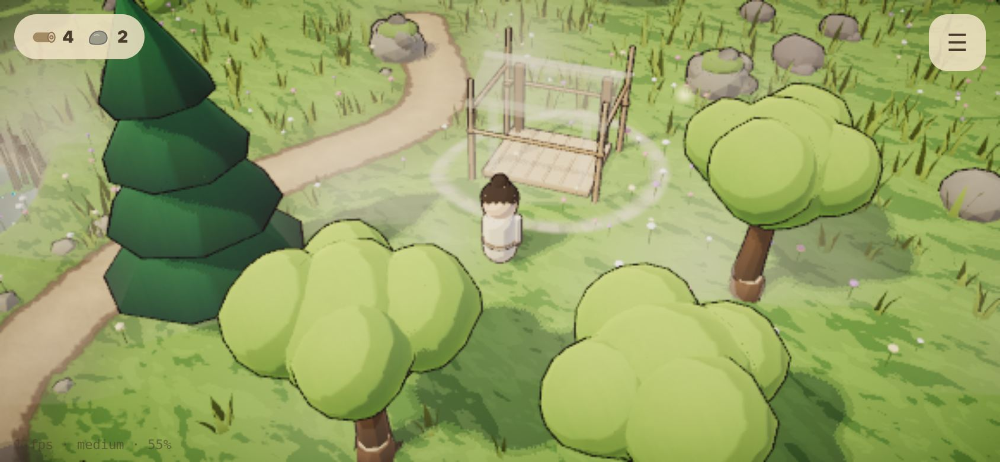

# Phase 1 gate: art decision points A2 (camera) and A3 (world scale)

Nothing here is locked. Both are **trial settings** in the game: open ☰ Settings → *Camera* and
*Caretaker size*. They are saved, so you can play a while with each. Please try them **on your phone**,
then tell the agent which you want; it records the choice in plan 7.4 and `docs/ART_PIPELINE.md`.

Screenshots: phone landscape (844 × 390, 2× pixels), Medium quality, the same spot between the trees
and a half-built shelter. They were rendered with software graphics in a container, not on a phone.

## A2: Camera angle, height and zoom range

| A · Classic (~40°) | B · High (~55°) | C · Low and close (~28°) |
|---|---|---|
|  |  |  |
| Phase 0 camera. Caretaker, nearby trees and the site fit on one phone screen. Front trees can cover the caretaker. | Steeper, closer to top-down. Trees hide the caretaker less and the layout reads like a board; less depth and sky. | Lower and more cinematic, closest to the painted reference's mood. Front canopies cover a lot of the screen; less overview. |

Each option has a near and a far zoom (pinch / mouse wheel). The numbers are in `src/data/feel.ts`.

**Why it gets expensive later:** the camera decides how big every model, path and build site must be
to read on a phone, how far apart things can be, and how much a tree in front hides. Once Phase 2
builds the Zen kit and Phase 3 lays out the whole valley for one camera, changing it means re-sizing
and re-spacing all of it.

## A3: World scale (the caretaker against trees, buildings and walking space)

| Small (1.4 m) | Medium (1.8 m, Phase 0) | Large (2.2 m) |
|---|---|---|
|  |  |  |
| Chibi-leaning: trees ~3.3× the caretaker, the shelter feels like a real hut. Matches the reference's proportions best. | Trees ~2.5× the caretaker. | Toy-like: trees ~2×. Everything reads easily at phone size; the shelter feels small. |

Only the caretaker changes size in this trial; trees (4–6 m, from Lanternfall) and spacing stay.

**Why it gets expensive later:** every place layout, gather and site radius, collision circle, path
width and building size is built around the caretaker's size. After Phase 2 builds the real caretaker,
the kit and the building parts at one scale, changing it means re-tuning all of them.

## Recommendation

- **A2: camera A (Classic)** as the base. It shows the caretaker, the nearest nodes and the site together
  on a phone, which the core loop needs. C is the closest to the reference's mood; if you like it, a
  middle ground (A's height with C's wider lens) is cheap to try now. Either way, Phase 2 should fade
  canopies that come between the camera and the caretaker (the known occlusion gap).
- **A3: small caretaker (1.4 m)**, matching the chibi proportions of the reference and the "open garden,
  lots of room to walk" target, if it still reads well on your phone. If it feels too small at arm's
  length, keep Medium.

Please decide both before Phase 2 starts building the real caretaker, the Zen kit and building parts.
