# Phase 3: Home grows — screenshots and notes for the gate

All pictures are Lanternfall+ at phone size (844 × 390, 2× pixels), taken with `npm run shots` (software
rendering in a container, about 1 fps). Debug helpers put facts in place and skip the easing, so each shot
shows a settled moment; in play, every change eases in over a few seconds.

## Before and after (gate: "before and after look clearly different")

| Before (fresh save) | After (all four buildings) |
|---|---|
| 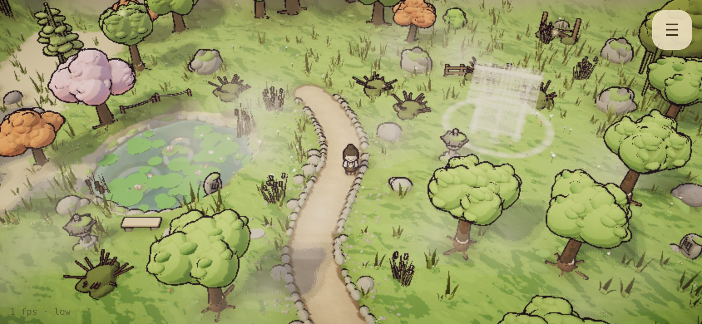 | 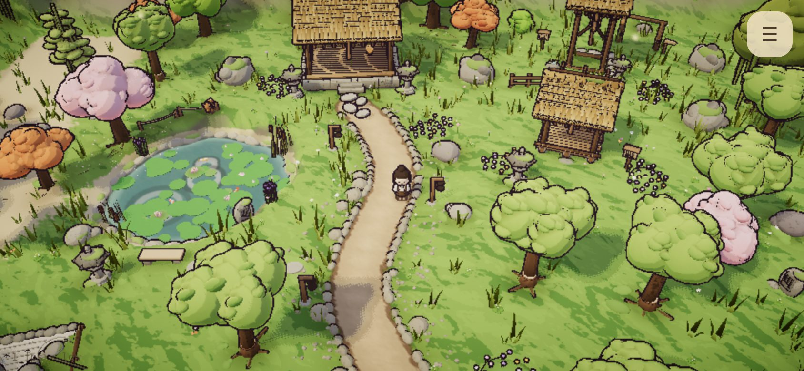 |
| 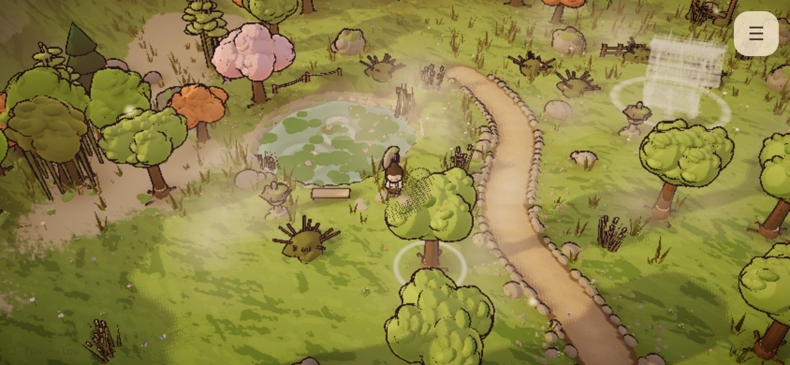 | 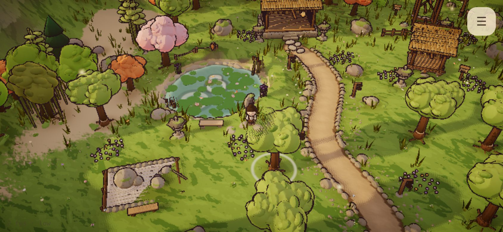 |

Before: mist over the floor, brambles and tall weeds in the clearings, tired brownish ground, a murky pond, only
the shelter's marker. After: the mist is gone, flowers and iris have spread, lanterns line the path, the pond is
clear, the ground has greened, the deer is at the pond and the trail gate stands open.

## The buildings (timber, built one part per unit)

| Caretaker's shelter (timber detail pass) | Gravel garden |
|---|---|
| 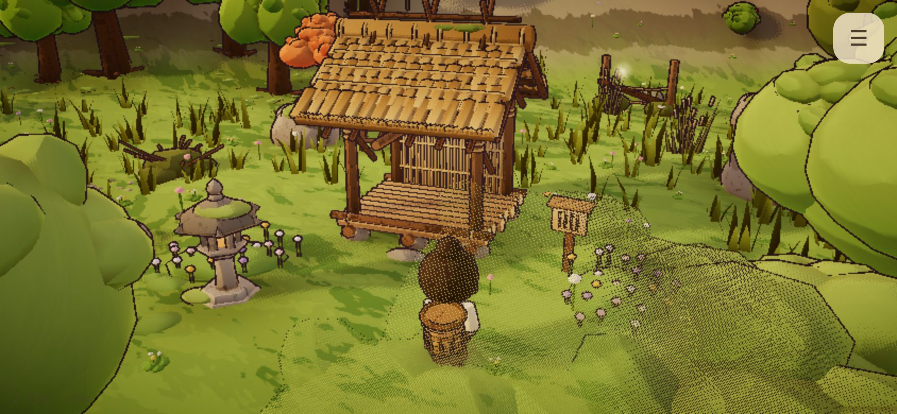 | 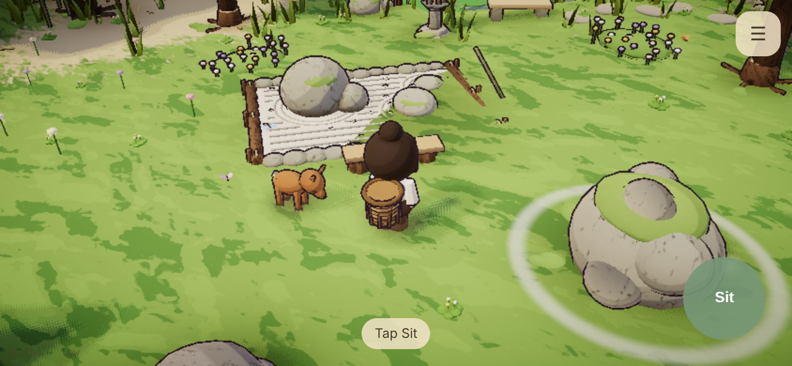 |
| **Meditation hall** | **Hall, half built** (9 of 14 wood, 5 of 10 stone) |
| 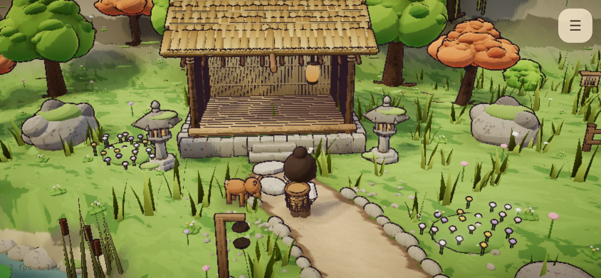 | 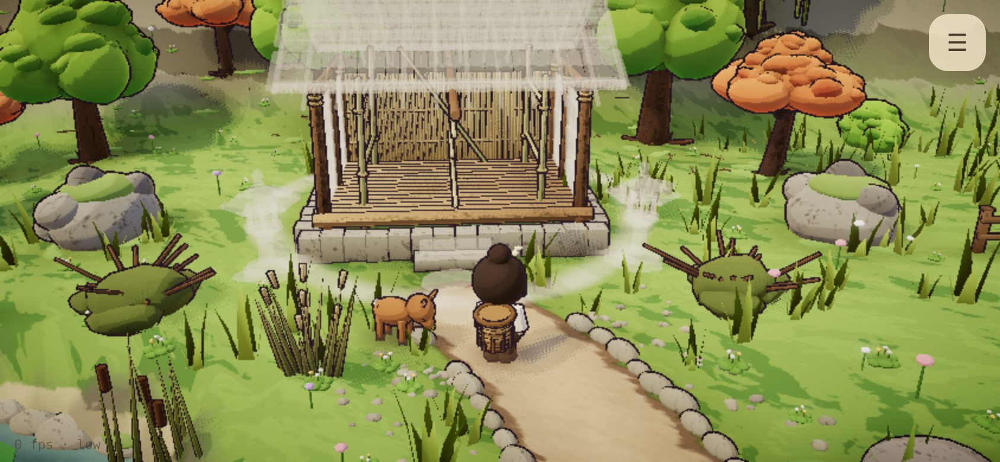 |
| **Bell tower** | **Ringing the bell** |
| 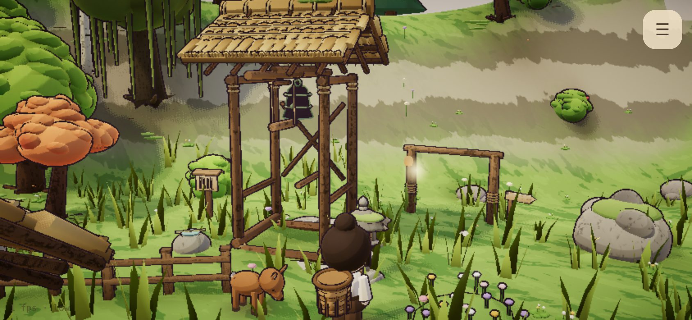 | 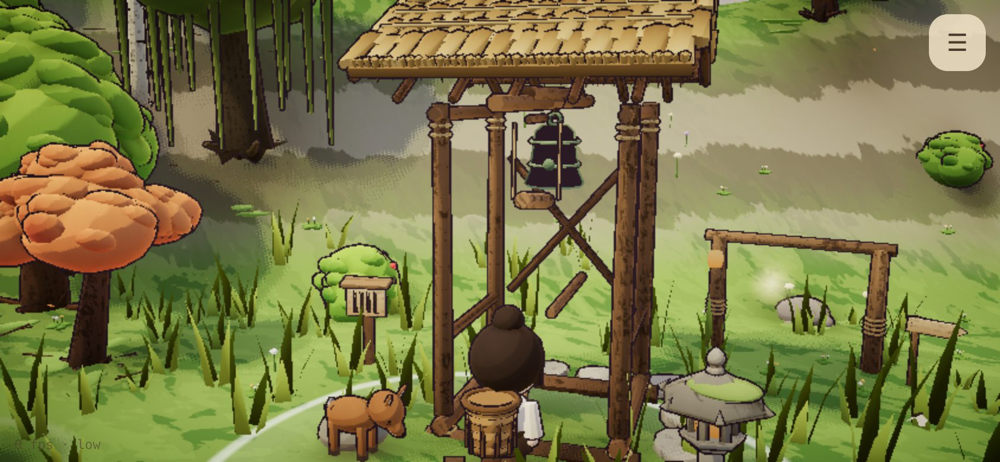 |

The half-built hall shows the mixed-material rule: stone and wood parts arrive in any mix, and nothing floats,
because every part rests on the ground or on its own material.

## Stillness, rituals and words

| Lighting the path lanterns at night | Sitting on the hall's step |
|---|---|
| 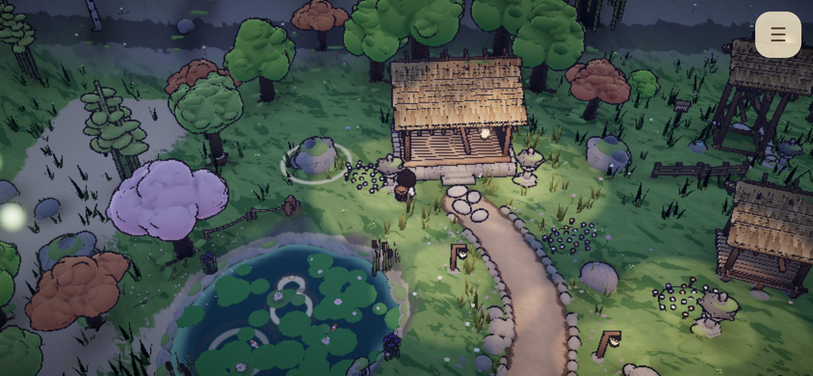 | 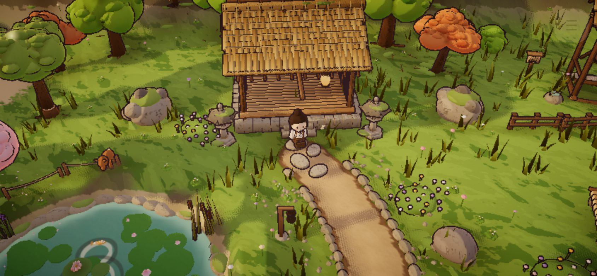 |
| **A poem stone** (draft text, PLACEHOLDER tag) | **The opening at the gate** (first visit only) |
| 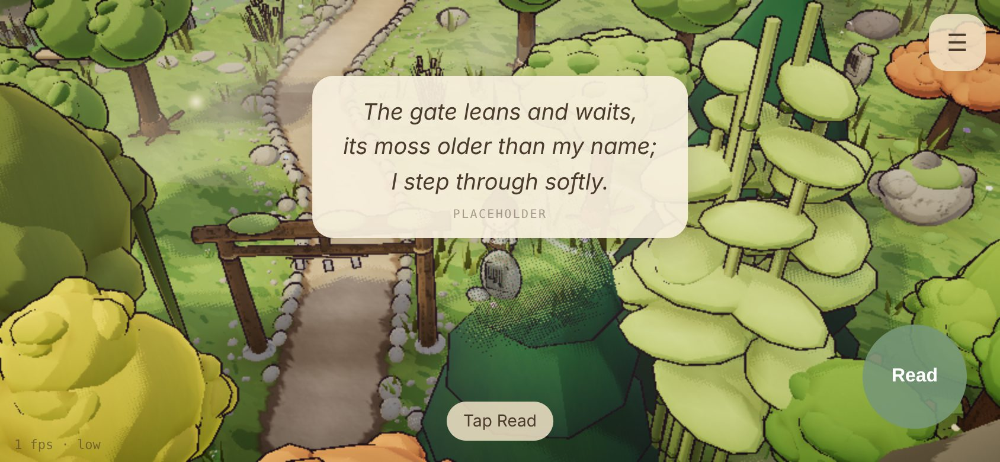 |  |

## What the owner needs to decide or approve

1. **Chapter 1's start (plan 4.5, open decision).** I built the default: the game begins just inside an old,
   leaning timber gate at the valley's south end, and three lines fade in one after another on the first visit:
   > Far enough from everything, the path grew quiet.
   > Beyond the old gate, a monastery sleeps under moss.
   > A quiet place can begin with one small act.

   The alternative is a short walk-in: a few metres of trail outside the gate before the valley. That costs a
   little layout (the island's south rim) and nothing else, so it stays cheap to change. **My recommendation:
   keep the gate start**; the gate already frames the arrival, and the first tree is a few steps away.
2. **All words are drafts** (`src/data/words.ts`): the opening, four poems and three caretaker notes. They are
   original; please rewrite or approve them. Drafts show a small PLACEHOLDER tag in the game.
3. **Pacing.** The gate asks for 10–15 minutes. A perfect bot builds the valley in ~2 minutes; a "relaxed" bot
   (three-quarter speed, pauses to look, sometimes a farther tree) in ~2.8 minutes. A first-time player also
   finds each site, reads, sits and tries the rituals, so I estimate 6–10 minutes, untested with a person. If it
   feels short when you play it, the change is data only. Options, from gentlest:
   - put trees and boulders a little farther from the sites (more walking, which the plan counts as rhythm);
   - fewer units per tree (5 → 4) so each building needs more nodes;
   - raise the plan 9.6 costs (e.g. the hall 14/10 → 18/14).
   I'd rather you play it first than pre-tune it.

No art decision point is touched by this phase: A1–A6 are decided, and nothing seasonal (A7) was built.
