# Phase 4: The first journey — screenshots and notes for the gate

All pictures are Lanternfall+ at phone size (844 × 390, 2× pixels), taken with `npm run shots` (software
rendering in a container, about 1 fps). Debug helpers put facts in place and skip the easing, so each shot
shows a settled moment; in play, every change eases in over a few seconds. The `closeup` helper also moves the
animals next to the caretaker, which is why the deer sometimes stands somewhere odd (on the tea house's deck).

## The way out

| The trail gate, open once the bell tower is built (map board on the left) | Arriving in the grove (walked the first time) |
|---|---|
| 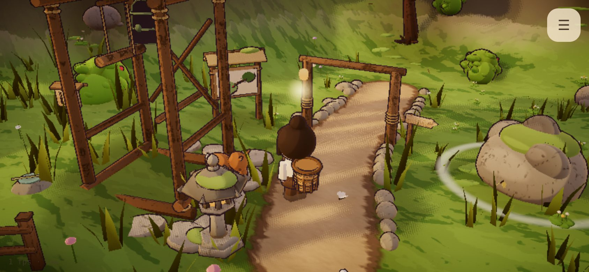 | 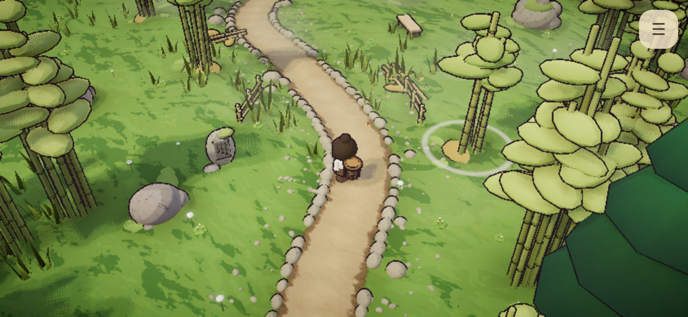 |

Walking out at the end of the trail fades the screen to paper and you arrive at the foot of the grove's own trail.
The first time, two lines fade in (draft): *"Past the trail gate, the path climbs into tall bamboo." / "Somewhere
ahead, an old shrine is listening for the wind."*

## The bamboo grove, before and after the wind shrine (gate: "restore the shrine")

| Before: mist, fallen culms, brambles, a murky pool | After: the shrine, ferns, trail lanterns, the crane |
|---|---|
| 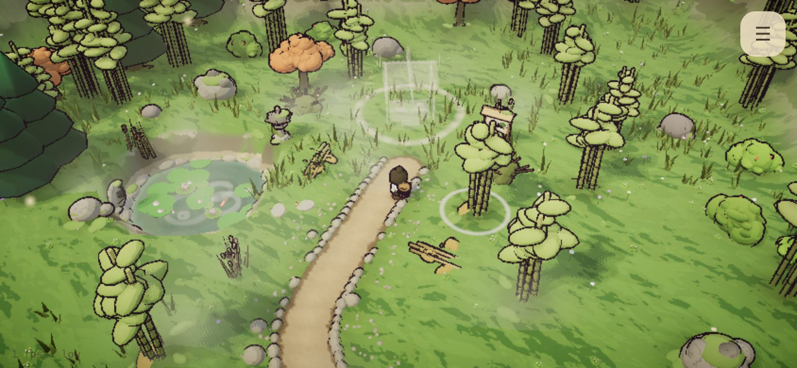 | 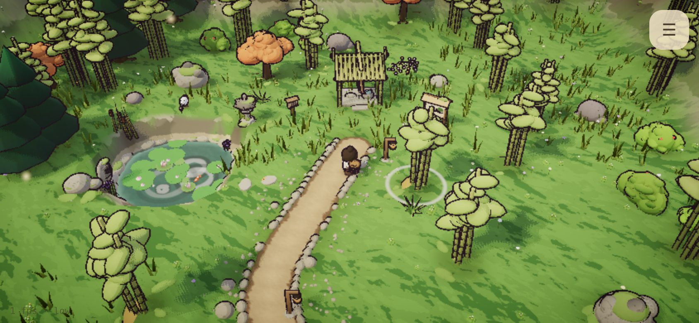 |
| **Cutting bamboo** (one culm per beat; bamboo in the basket and the HUD) | **The shrine, half built** (2 of 4 stone, 4 of 8 bamboo) |
| 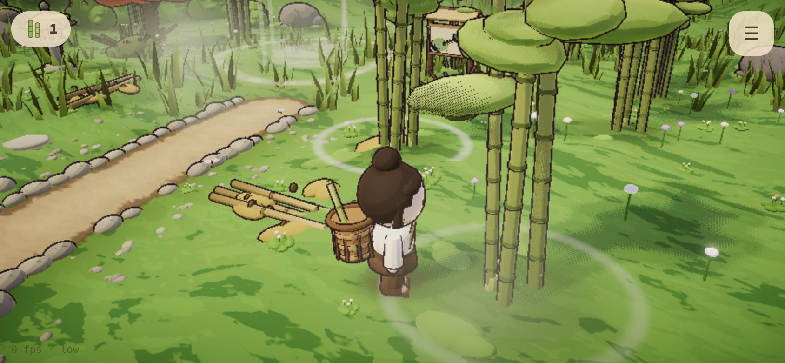 | 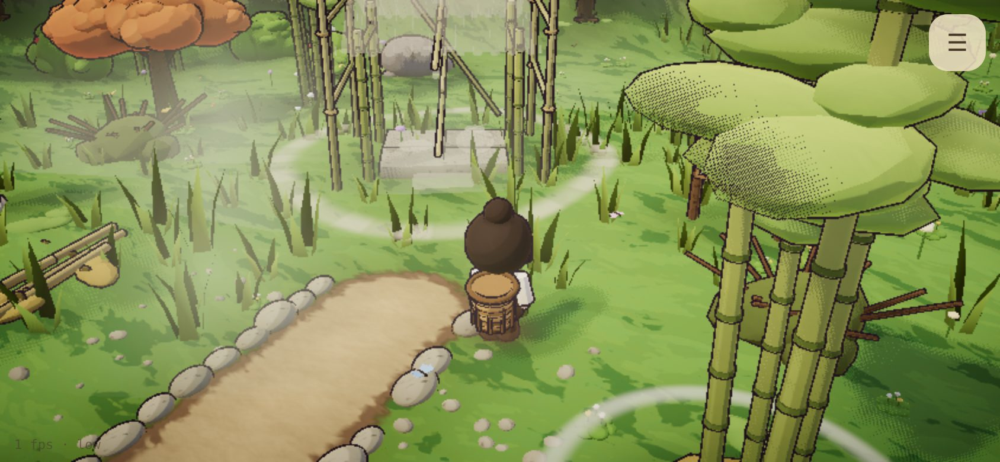 |
| **The wind shrine** (chimes under the eave sway; their sound joins the grove) | **The crane** at the spring pool |
| 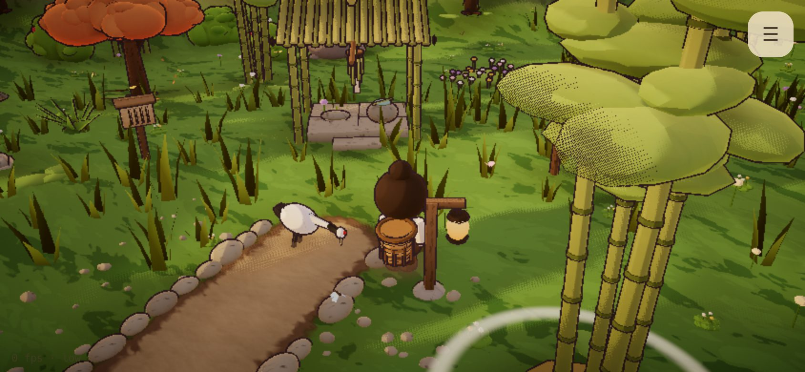 | 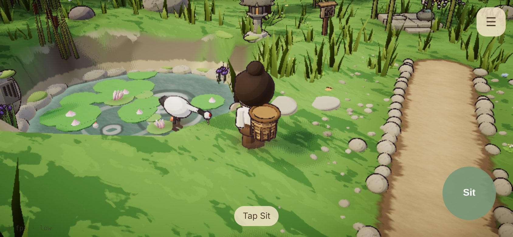 |
| **The grove at dusk** (the trail lanterns light themselves) | **The travel map** (from either map board) |
| 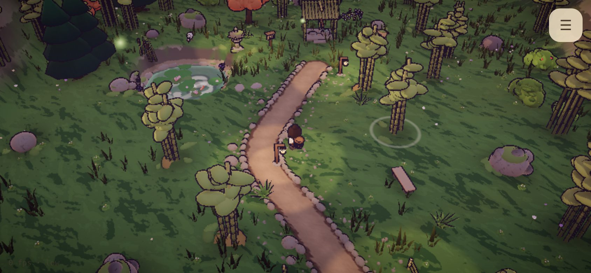 | 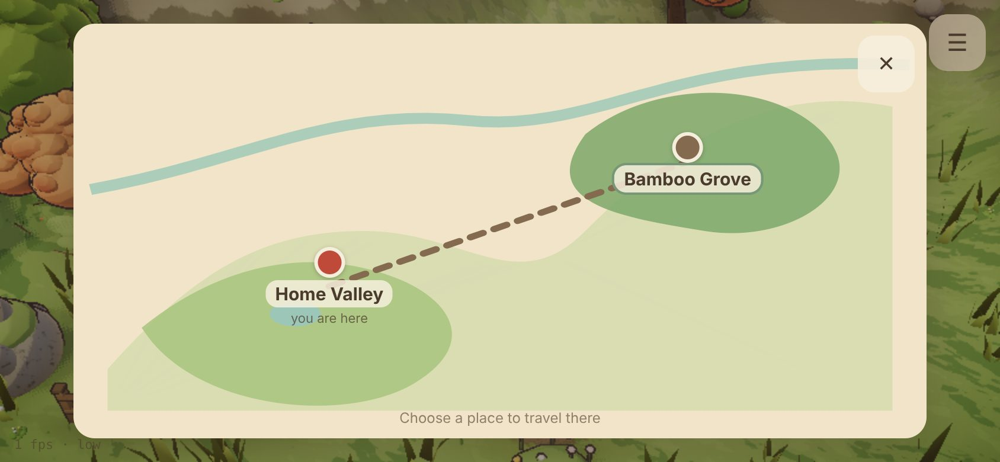 |

## Home again: the tea house (gate: "bring bamboo home, build the tea house")

| Half built (4 of 6 wood, 3 of 8 bamboo) | Finished, beside the gravel garden |
|---|---|
| 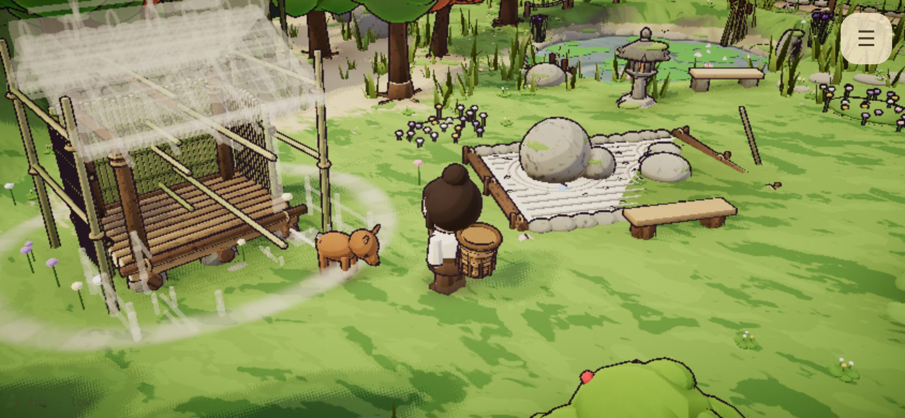 | 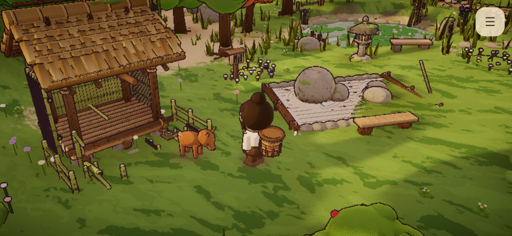 |
| **The tea ritual**: kneeling at the bench, steam rising | |
| 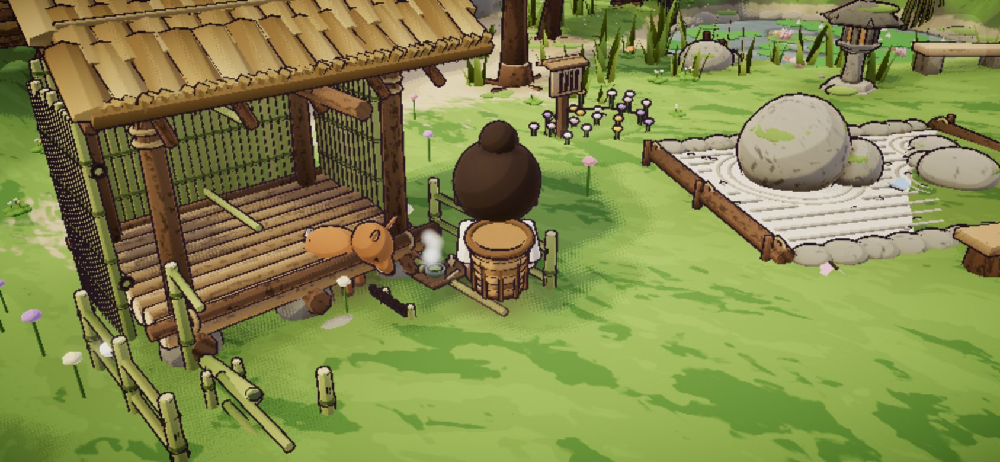 | |

The water pipe in the tea garden fills, tips and knocks every ~7.5 s: a splash you see, a tock you hear nearby.

## What the owner needs to decide or approve

1. **The new words are drafts** (`src/data/words.ts`): two grove poems, the shrine's note (it also hints that bamboo
   is wanted at home), the tea house's note, and the grove's two arrival lines.
2. **Where the home map board stands.** Plan 4.1 says "at the home gate". I put it by the **trail gate** (where
   journeys begin), not the old gate at the valley's south end. One line of data to move.
3. **Pacing**, as in Phase 3: the journey bot does the grove and tea house in ~1.1 min (perfect) and ~1.4 min
   (relaxed), against the plan's 10–15 minutes. The levers are data only. Please play it first.
4. **Art follow-up (cheap, not an A-point):** the grove's background bamboo is the Phase 2 decor clump, whose leaf
   tufts read as big flat ovals next to the new gatherable clumps. A finer bamboo crown (thin culms, small leaf
   sprays) would suit the grove; I'd do it as a detail pass if you agree.

No undecided art decision point was built on: everything uses A1–A6 as decided; A7 (seasons) is untouched.
