# Phase 5: Seasons, collections, decorating

**Status: built, stopped at art decision point A7 (seasonal palettes) for the owner.** Nothing is locked.
All screenshots: Lanternfall+ at phone size (844×390 @2×), every building restored, rendered in software
GL in a container (not on a phone or your PC).

## ⚠ A7: the palette for each season — please decide

**What must be decided:** what each season looks like in both places: how far the ground, grass, crowns,
water and air change, and how strong the colors are. The season *system* is built and works with any palette.
Three candidate palettes are in the game, switchable live: **Settings → Season palette**, together with
**Settings → Season** to pick a season.

| | Classic (A) | Gentle (B) | Bold (C) |
|---|---|---|---|
| Idea | The four seasons as most people picture a Japanese garden | Softer change, green all year | Woodblock-print color |
| Spring | Authored look: cherry pink, pastel flowers, petals in the air | Same, fewer petals | Pink crowns on every leafy tree, petals everywhere |
| Summer | Deep green, hydrangea blues | Slightly warmer green | Saturated deep green |
| Autumn | Red, orange and gold maples; golden ground; fallen leaves | Amber and gold, few reds | Vermilion, rust ground |
| Winter | Real snow on ground, roofs, crowns; icy pond | Light frost, grass shows through | Deep snow, cool blue light |

### Home valley, by day
| | Spring | Summer | Autumn | Winter |
|---|---|---|---|---|
| **Classic** | 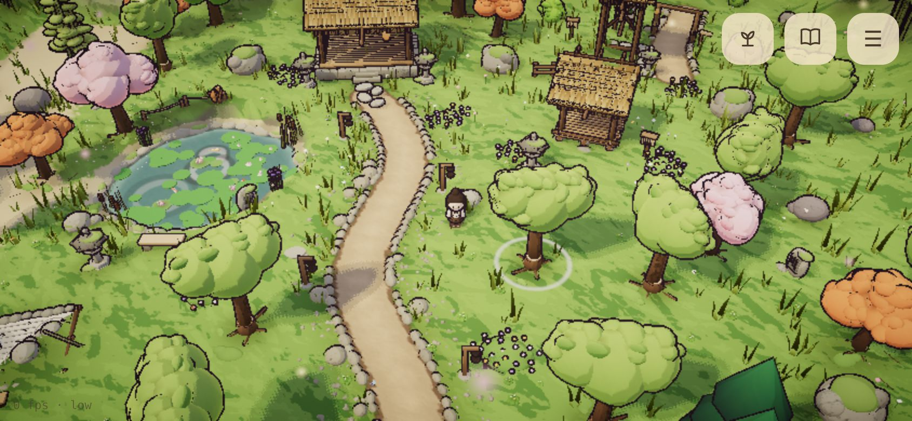 | 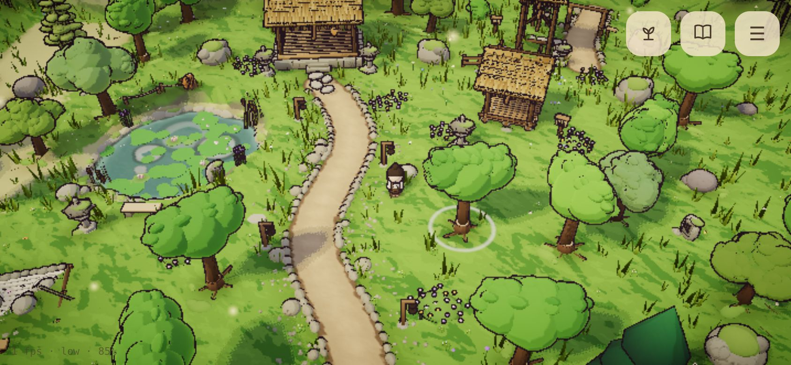 | 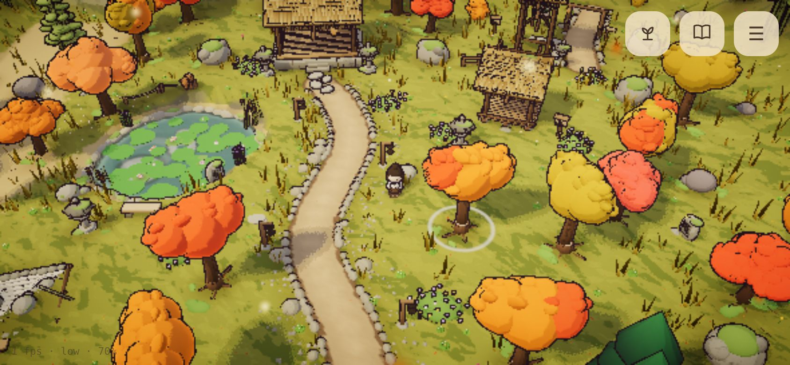 | 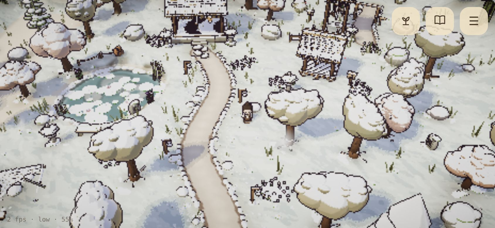 |
| **Gentle** | 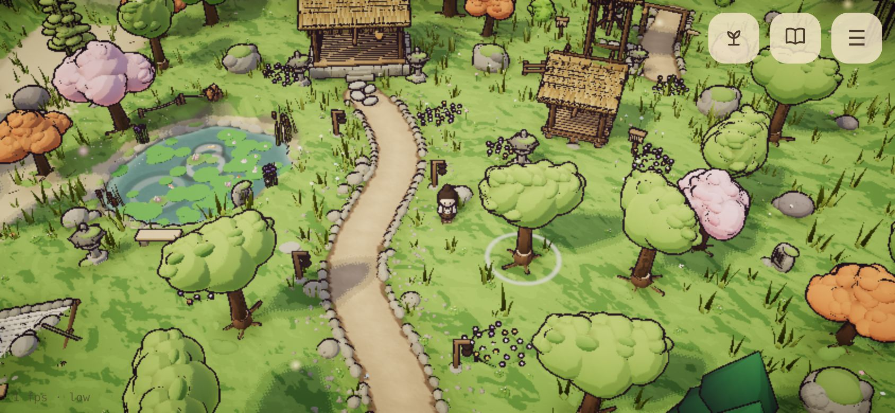 | 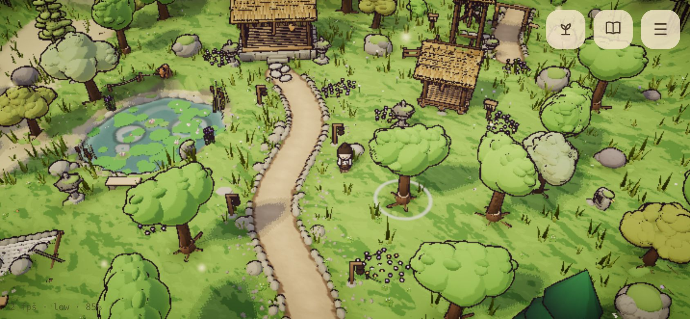 | 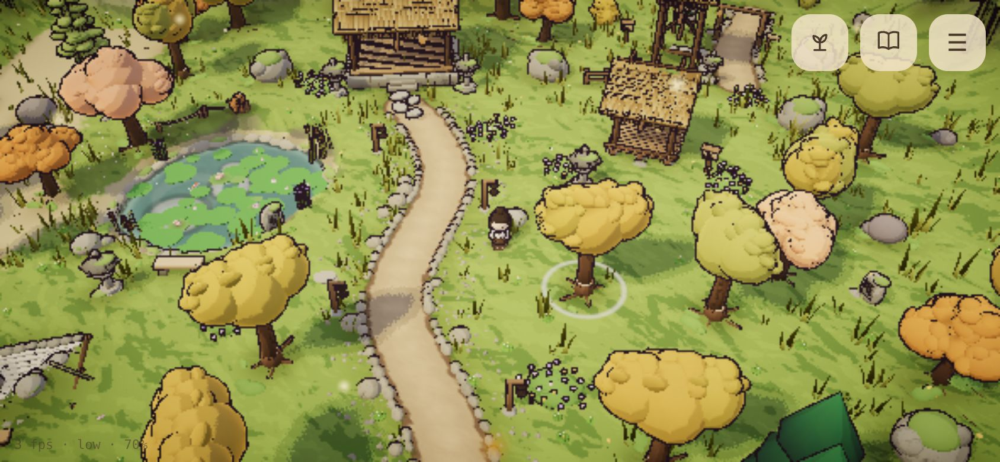 | 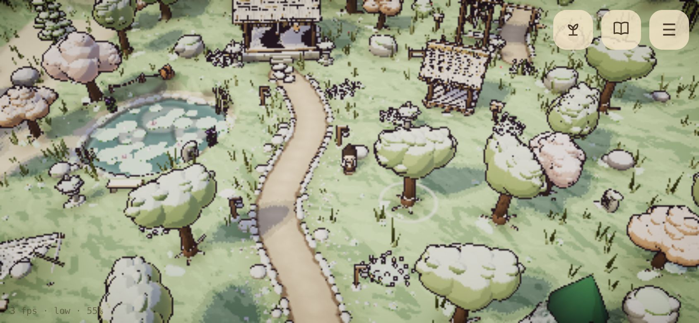 |
| **Bold** |  | 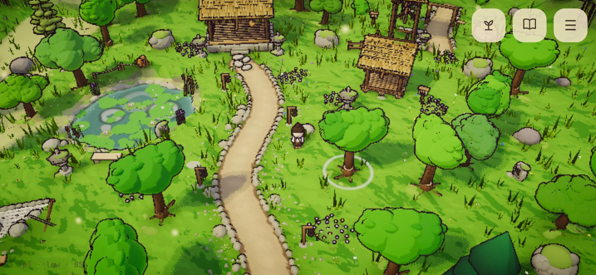 | 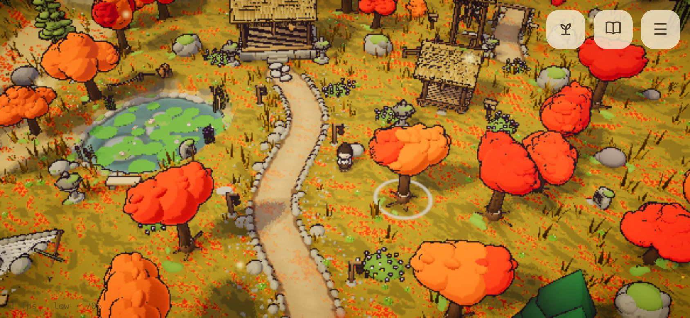 | 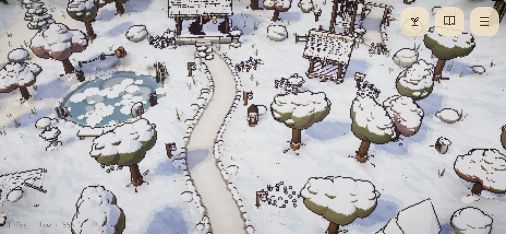 |

### Bamboo grove, by day
| | Spring | Summer | Autumn | Winter |
|---|---|---|---|---|
| **Classic** | 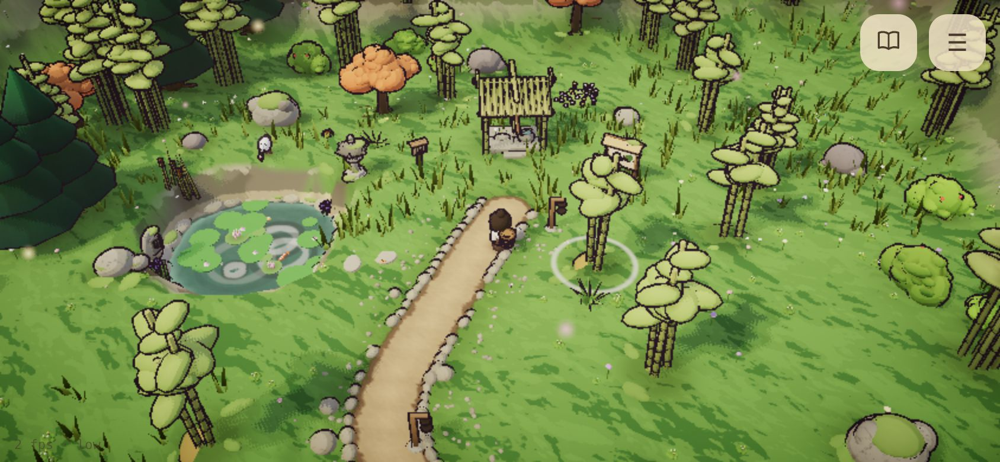 |  |  |  |
| **Gentle** |  |  |  |  |
| **Bold** | 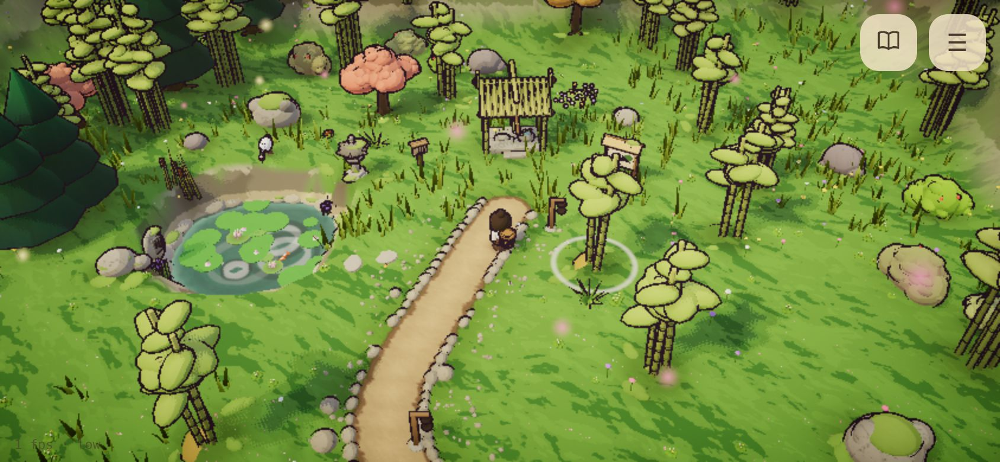 |  | 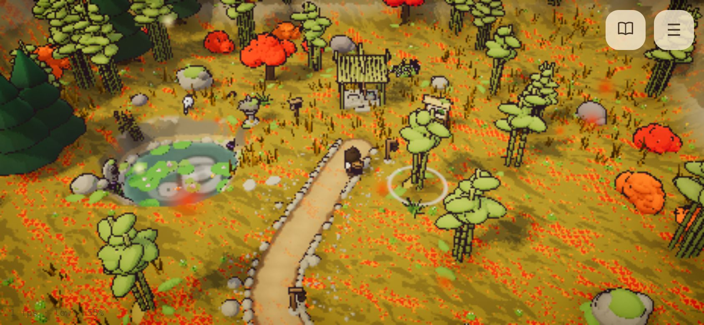 | 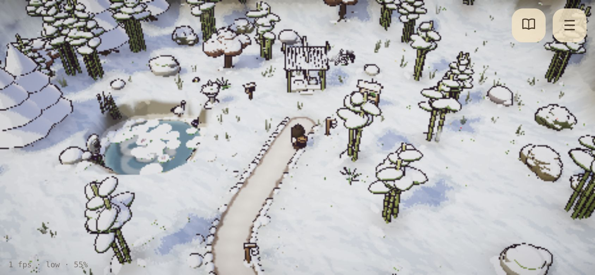 |

### With the time of day (Classic)
| Autumn dusk | Winter night |
|---|---|
| 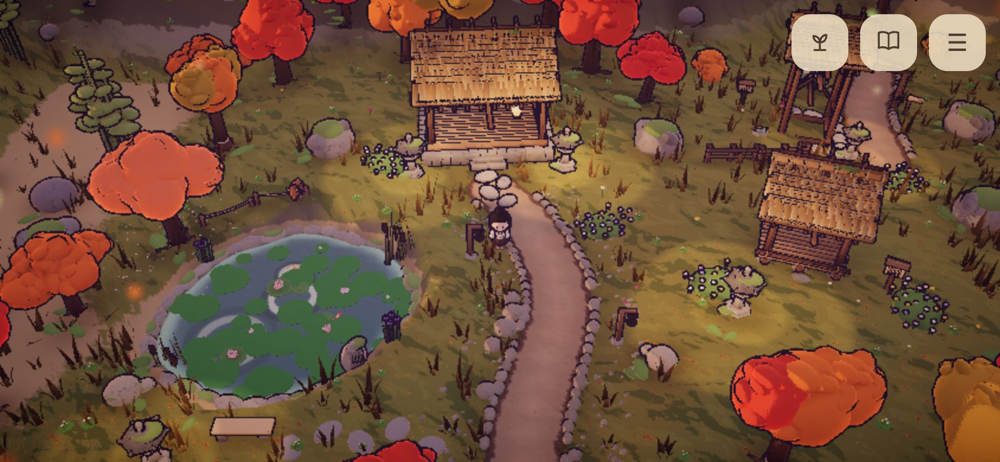 | 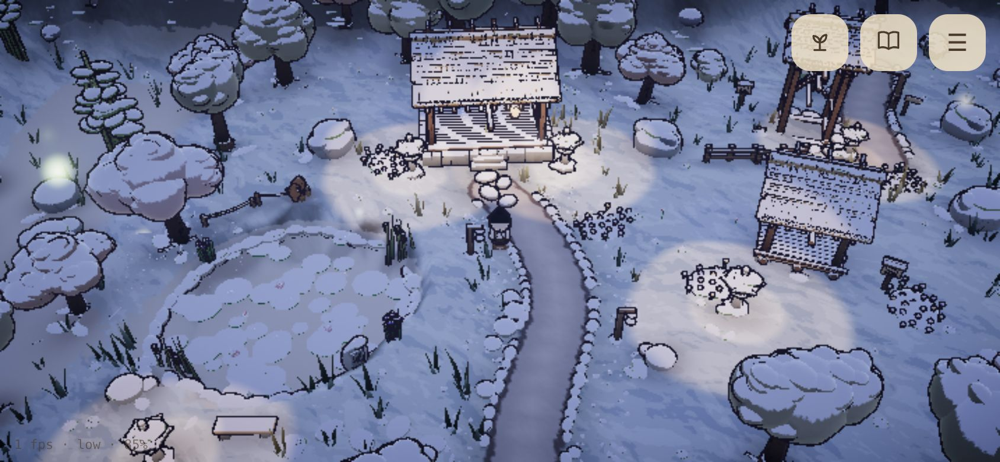 |

**What gets expensive to change after A7:** every later place (riverbank, mountain pass) and every new
prop, seasonal find and decoration will be checked and tuned against the chosen palette, in all four
seasons. Each palette value is cheap on its own (data in `src/data/seasons.ts`), but retuning many places and
props later costs a lot in total. The season *system* (what changes, how) is not part of A7 and stays.

**Also cheap to mix:** a palette is per season, so "Classic, but Gentle's winter" (or Bold's autumn) is one
line of data.

**My recommendation: Classic.** The gate asks that "setting the season to each of the four makes both places
look clearly different", and Classic does that most clearly while staying inside Lanternfall+ (crisp bands, ink,
rich color). Gentle is calm but its seasons blur together, especially in the grove, where bamboo stays green
anyway (in every palette, the grove's spring and summer are the closest pair). Bold is striking in autumn but pink trees in spring everywhere stray from the reference (cherries are
special because they are few), and its winter is cold for a calm game. If Classic's winter feels too heavy
(snow covers a lot of the detail you asked for), take Gentle's winter with Classic's other three.

After you pick: the unpicked palettes and the Settings palette menu are removed, the plan's A7 row is filled in,
and a short tuning pass follows on the chosen one.

## The rest of Phase 5

### Seasonal finds and the collection book
One small thing per place per season, out only in that season (8 in all). Walk up and **Look**; a wordless card
shows it and it goes into the book. Never needed for anything; Settings → Season makes every one reachable.

| At autumn's maple leaf ("Look") | The card |
|---|---|
|  |  |

(My close-up camera didn't frame the finds well: trees stand between it and them. In play they are small
objects with a soft glint; whether they are easy enough to spot is worth a look on your PC.)

The **book** (book button, or B): finds by place and season (silhouettes until found), animal friends met
(derived from what you've built), and every poem and note found (blank cards until read).

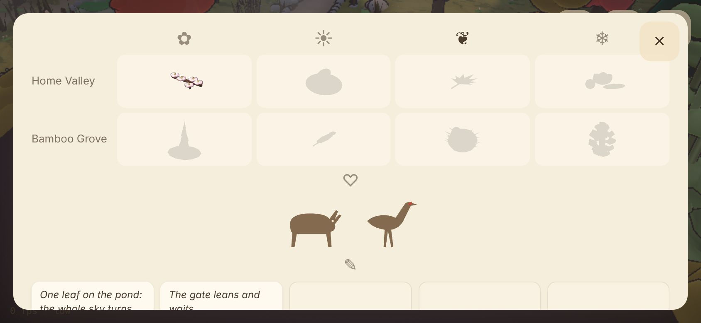

### Decorating v1 (at home)
The **sprout button** (or F) opens decorate mode: a tray of decorations offered by completed buildings and the
wind shrine (14). Pick one, walk it to a spot (it goes ahead of the caretaker as a green ghost, red where it
can't go), **⟳ / R** turns it, **Place / E** puts it down; walk up to a placed one and **Remove**. It may only go
on dry valley floor with room around it, off the path, and clear of build sites, gather trees, seats, words,
finds, the map board and exits; and a flood fill refuses anything that would cut the caretaker off from any of
them. Decorations are saved; nothing is spent, nothing is given back.

| Decorated (lantern, cherry, flower bed, bench, mossy stone) | Decorate mode with the tray and a ghost |
|---|---|
|  | 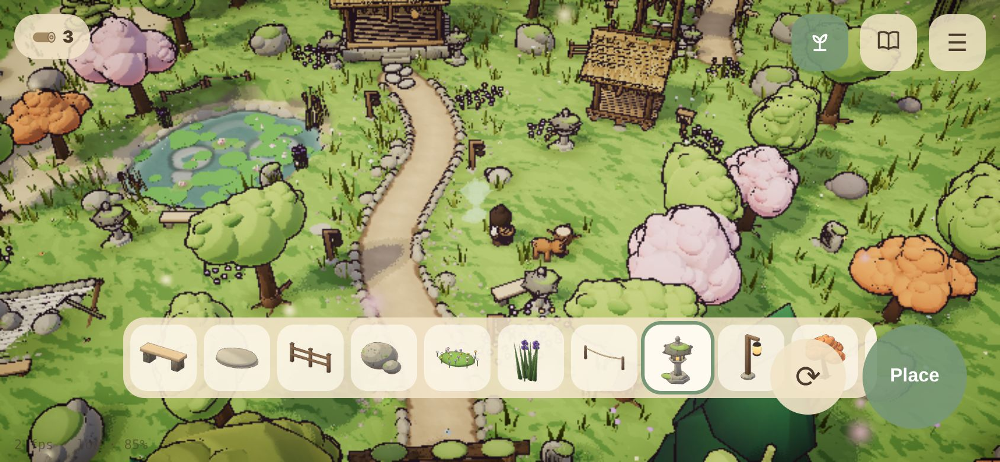 |

### Building styles (A5)
In decorate mode, walk up to any revealed building: **Style: Temple / Timber** switches it, free and changeable.
The plan left open whether you pick at the build site or restyle afterwards; **I chose: restyle any time**
(before, during or after building), from decorate mode. Easy to change if you prefer otherwise.

| The hall in temple style | …in winter |
|---|---|
| 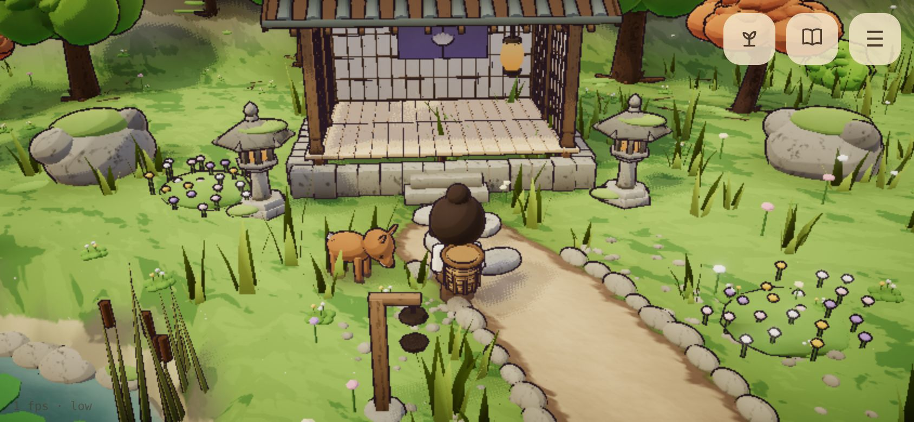 |  |

## How to try it
1. `npm run build`, open `dist/index.html` (or `npm run serve`).
2. Settings → **Season**: follow the calendar (today: autumn in the north) or pick one; **Season palette**:
   Classic / Gentle / Bold. Both switch live, in both places.
3. Build at least the shelter, then the sprout button (or F) at home to decorate; walk up to a building to
   restyle it. The book button (or B) for the collection.
